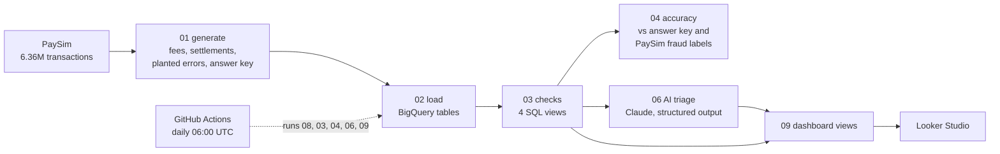

# Payments Assurance Monitor

[](https://github.com/tobigiwa15-bit/payments-assurance-monitor/actions/workflows/daily.yml)

Continuous assurance over **every** payment transaction, not a sample:

1. Rule-based checks in a cloud warehouse find the exceptions.
2. An LLM triages them.
3. A dashboard reports what was found and how much it's worth.

All of it reruns automatically every day.

**Live dashboard:** [Payments Assurance Monitor on Looker Studio](https://lookerstudio.google.com/reporting/c8617948-107f-4fe9-88c2-6ec610b28a22)

All data is synthetic: the public PaySim dataset plus fees and settlements generated by this repo. Nothing here comes from a real institution.

---

## Results at a glance

| What | Result | Produced by |
|---|---|---|
| Transactions checked | **6,362,620** | `scripts/02_load_to_bigquery.py` (load control) |
| Exceptions raised | **14,008** across 4 checks | `scripts/03_create_checks.py`; totals in `scripts/09_create_dashboard_views.py` → `dash_summary` |
| Revenue leakage found | **13,873,496.60** | same |
| Amount owed to merchants | **12,702,288.36** | same |
| Planted-error checks (fee, settlement, duplicate) | **100% precision, 100% recall**: 5,000 of 5,000 planted errors, 0 false positives | `scripts/04_measure_accuracy.py` → `results/accuracy_by_check.csv` |
| Legitimate look-alikes wrongly flagged | **0 of 4,182** | `results/lookalikes_flagged.csv` |
| Fraud rule (account drained in one move) | **100% precision, 97.5% recall**: 8,008 of 8,213 frauds | `results/accuracy_by_check.csv` |
| PaySim's own fraud flag, for comparison | 0.2% recall (16 of 8,213) | same |
| Exceptions hand-labelled, blind, before any AI run | **100** (25 per check) | `labels/hand_labels.csv` |
| AI agreement with my labels | **Claude Opus 5.5: 100%** · Claude Haiku 5.5: 93% | `scripts/07_measure_agreement.py` → `results/agreement_summary.csv` |

**Read these numbers with the caveats in [What the numbers do and don't show](#what-the-numbers-do-and-dont-show).** Several of the 100% figures are 100% by construction.

---

## How it works



- **Warehouse:** Google BigQuery (free sandbox). Money is stored as `NUMERIC`, never floats, and fees are calculated in integer cents with half-up rounding.
- **Checks are SQL views,** so the logic lives in version-controlled files in `sql/checks/`. The dashboard does no maths of its own: every figure comes from the views in `sql/dashboard/`.
- **Schedule:** `.github/workflows/daily.yml` is scheduled for every morning. GitHub treats the time as best-effort, and scheduled runs have started several hours late. Each run:
  1. rebuilds any table or view the sandbox is about to delete;
  2. refreshes the checks and accuracy figures;
  3. triages the next 20 exceptions in the queue;
  4. rebuilds the dashboard views.
- **Sandbox expiry, learned the hard way:** the sandbox deletes objects 60 days after they're *created*. The first keep-alive pushed expiry dates forward, and BigQuery started rejecting that once the tables were two days old. The fix rebuilds an object as a copy of itself (`CREATE OR REPLACE TABLE x AS SELECT * FROM x`), which restarts its 60-day clock. A row-count control confirms nothing was lost (`scripts/08_keep_tables_alive.py`).
- **Secrets:** API keys and the service-account key live in a git-ignored `.env` locally and in GitHub Actions secrets in CI. The service account has only two roles: BigQuery Data Editor and BigQuery Job User.

### The four checks

| Check | Control question | Rule | File |
|---|---|---|---|
| Fee recompute | Was every customer charged the tariff? | Recompute the fee from the banded fee schedule (rate in basis points, fixed fees, caps) and flag any difference of 0.01 or more. | `sql/checks/01_fee_recompute.sql` |
| Settlement reconciliation | Did every merchant receive exactly what they were due, and nothing that wasn't due? | Full outer join of merchant payments (amount − fee) against the settlement ledger, as at day 30. | `sql/checks/02_settlement_recon.sql` |
| Duplicate settlement | Was any payment settled more than once? | Settlements minus reversals > 1 per payment. | `sql/checks/03_duplicate_settlement.sql` |
| Fraud: account drained | Did anyone empty an account in one move (an account-takeover pattern)? | A TRANSFER or CASH_OUT moves the whole non-zero balance out, leaving zero. | `sql/checks/04_fraud_account_drain.sql` |

The settlement check handles two cases that trip up naive reconciliations. **Cut-off:** payments made on day 30 settle on day 31, so they're pending, not missing. **Reversals:** a settlement that was reversed and correctly re-sent nets to the right amount.

---

## How accuracy was measured

An assurance check is only useful if you know how often it's right. So the test was designed before any results were seen.

**Planted errors with an answer key.** `scripts/01_generate_data.py` adds fees and a settlement ledger to PaySim. It then plants known errors with a fixed random seed (42), so anyone who reruns it gets the identical answer key:

- 1,000 fees not charged and 1,000 charged at a stale rate (20% too low);
- 1,000 settlements missing, 1,000 duplicated, and 1,000 paid at the wrong amount (±0.1% to 5%).

**Legitimate look-alikes.** These are cases that *look* like errors but aren't, and they test for false positives:

- 500 settlements reversed and correctly re-sent;
- 3,682 payments still pending at the day-30 cut-off.

**Real fraud labels.** The fraud rule is scored against PaySim's `isFraud` labels, which this project didn't create.

**Order of work, visible in the commit history:**

1. The fraud rule was committed (`6ff4bd8`) before its accuracy was measured (`e24f04d`).
2. The 100 hand labels and the AI prompt were committed (`63fd7d4`) before the AI was run (`cebf561`).
3. The scoring rules were fixed before the first measurement and are written at the top of `sql/accuracy/01_accuracy_by_check.sql`.
   - One rule worth knowing: a duplicate also fails the reconciliation, so the reconciliation's 3,000 flags include the 1,000 duplicates as true positives.

---

## AI triage

Each exception's evidence is sent to Claude, which returns exactly one category with a short investigation note:

- the transaction;
- the fee band;
- the settlement history.

The categories are `fee_error`, `data_error`, `likely_fraud` or `needs_investigation`, and the rubric is in `labels/LABELLING_GUIDE.md`.

- **Structured output:** a JSON schema with an enum, so the model can't invent a category.
- **Traceability:** every answer is stored with the prompt version and SHA-256 fingerprint, the model requested and the model that actually served it, a run ID and token counts (`triage_results` table).
- **Daily queue:** the scheduled run works through every exception, 20 a day (`sql/triage/02_triage_queue.sql`). It takes turns across the four checks, largest amount first within each, so fraud flags (8,008 of the 14,008) don't crowd out the rest. Answers feed the dashboard's triage page, and the "open items" count falls as the queue is worked.
- **Cost control:** an exception already answered by the same model and prompt version is never sent again, and each run is capped at 20. With Opus that's about $0.16 a day. The benchmark runs cost about $0.80 (Opus, 100 exceptions) and $0.02 (Haiku).
- **The benchmark stays separate:** queue answers carry no `sample_id`, and `scripts/07_measure_agreement.py` scores only runs over the 100 hand-labelled exceptions.

**Benchmark:**

- I hand-labelled 100 exceptions (25 per check) blind, before any AI output existed.
- Opus 5.5 agreed on 100 of 100.
- Haiku 5.5 agreed on 93: it scored 84% on fee errors and 88% on settlement errors, and 100% on the other two checks.
- **Haiku's main failure mode:** it escalated fee and settlement errors to "likely fraud" or "needs investigation" because it over-read PaySim's inconsistent account balances. That accounts for 5 of its 7 disagreements, and none of those 5 transactions were fraud.
- Opus noticed the same anomalies but kept the correct category. It mentioned them as a secondary thing to check.

Opus is the model used in the daily run.

---

## What the numbers do and don't show

- **The planted-error checks score 100% by construction.** I wrote the planting code and the checks, so they mirror each other. The meaningful evidence is that **0 of 4,182 legitimate look-alikes** were flagged, which shows the cut-off and reversal logic works.
- **The fraud rule's 100% precision is a PaySim artefact.** In PaySim, no legitimate transaction ever moves exactly the full balance: legitimate rows left at zero all asked for *more* than the balance. Balances add up in 99.5% of fraud rows against 9.2% of legitimate rows (`results/fraud_no_false_positives.csv`). On real data, expect lower precision.
- **The 205 frauds the rule missed** (`results/fraud_misses.csv`):
  - 150 moved only *part* of the balance, and 145 of those sat at PaySim's 10M per-transaction cap, so they're chunked drains;
  - 41 had the balance recorded as zero beforehand;
  - 14 had balances that don't add up.

  I didn't build a "v2" rule to catch them: anything designed now would be tuned on the same labels it's scored against.
- **100% AI agreement is a low bar here.** My labels turned out to follow the check name exactly (fee check → `fee_error`, and so on), so a simple lookup would also score 100%. The sample had no genuinely ambiguous cases. The AI's real value in this project is its investigation notes, not its categories.
- **Leakage isn't double-counted.** Every duplicate settlement also fails the reconciliation, so duplicates carry zero leakage in the dashboard and the overpayment is counted once.

---

## Next steps

- **Keyless authentication:** replace the service-account key in CI with Workload Identity Federation.
- **A harder AI benchmark:** a labelled set of genuinely ambiguous exceptions, where the category isn't implied by the check that raised it.
- **A windowed fraud rule:** catch chunked drains (several transfers at the cap within hours), validated on a held-out split of the labels.
- **Fuzzy duplicate detection:** same merchant and amount within a time window, not just the same payment ID.
- **Incremental data loads** instead of a full reload, once the data changes daily.
- **Schedule keep-alive:** GitHub pauses scheduled workflows in a public repo after 60 days without a commit.

---

## Run it yourself

Requirements:

- Python 3.14;
- a Google Cloud project with BigQuery (the free sandbox is enough);
- a Claude API key, for the triage steps only.

1. Download PaySim, *Synthetic Financial Datasets For Fraud Detection*, from Kaggle (`ealaxi/paysim1`) and save it as `data/paysim.csv`.
2. Create a virtual environment and install the pinned packages:
   ```
   python -m venv .venv
   .venv\Scripts\Activate.ps1        # Windows; use source .venv/bin/activate elsewhere
   pip install -r requirements.txt
   ```
3. Copy `.env.example` to `.env` and fill in your project ID, the path to your service-account key, and your Claude API key.
4. Run the scripts in order:

| Step | Command | What it does |
|---|---|---|
| 0 | `python scripts/00_check_setup.py` | Checks BigQuery and Claude access (costs nothing) |
| 1 | `python scripts/01_generate_data.py` | Fees, settlements, planted errors, answer key |
| 2 | `python scripts/02_load_to_bigquery.py` | Loads 5 tables, with row-count and amount controls |
| 3 | `python scripts/03_create_checks.py` | Creates the 4 check views and prints exception counts |
| 4 | `python scripts/04_measure_accuracy.py` | Precision and recall → `results/` |
| 5 | `python scripts/05_build_triage_sample.py` | Exports the 100-exception sample for blind labelling |
| 6 | `python scripts/06_triage_with_llm.py --model claude-opus-5-5 --max 100` | AI triage of the 100-exception benchmark |
| 7 | `python scripts/07_measure_agreement.py` | AI agreement with the hand labels → `results/` |
| 8 | `python scripts/08_keep_tables_alive.py` | Rebuilds tables and views close to the sandbox's 60-day deletion |
| 9 | `python scripts/06_triage_with_llm.py --source queue --max 20` | The daily queue triage (what the schedule runs) |
| 10 | `python scripts/09_create_dashboard_views.py` | Dashboard views and headline totals |

## Repository layout

```
scripts/            numbered pipeline steps (Python)
sql/checks/         the four assurance checks
sql/accuracy/       scoring against the answer key and fraud labels
sql/triage/         the triage sample
sql/dashboard/      views the dashboard reads
prompts/            the AI triage prompt (versioned)
labels/             labelling guide and the 100 blind hand labels
results/            accuracy, agreement and triage outputs (committed)
.github/workflows/  the daily scheduled run
```

## Data and credits

- **PaySim:** E. A. Lopez-Rojas, A. Elmir and S. Axelsson, *PaySim: A financial mobile money simulator for fraud detection*, 28th European Modeling and Simulation Symposium (EMSS), 2016. The dataset is published on Kaggle under CC BY-SA 4.0. The fees, settlements, planted errors and answer key are generated by this repo.
- **Built with AI assistance:** I used Claude Code as a pair programmer while building this. The design choices, hand labels, scoring rules and the review of every result are my own.
